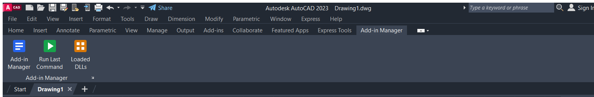
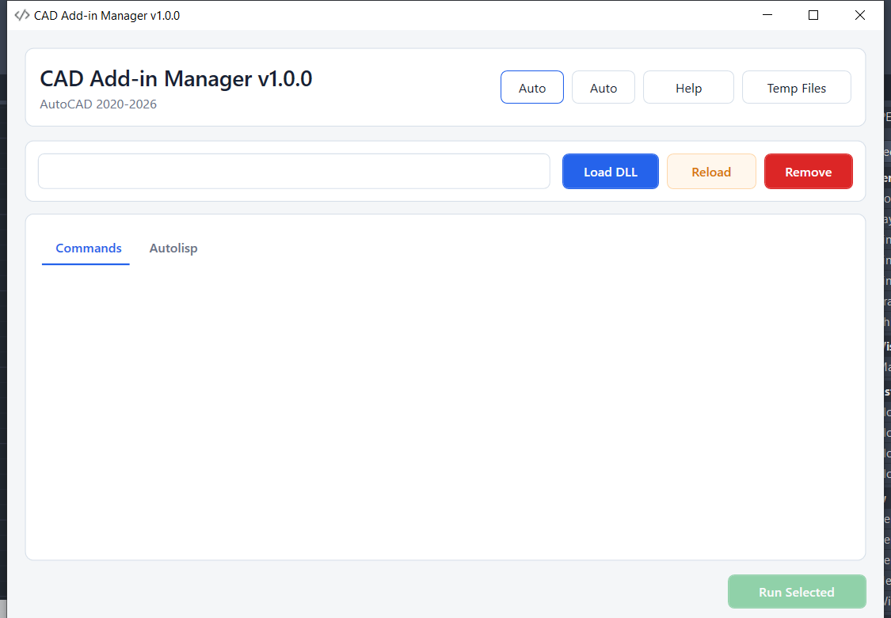
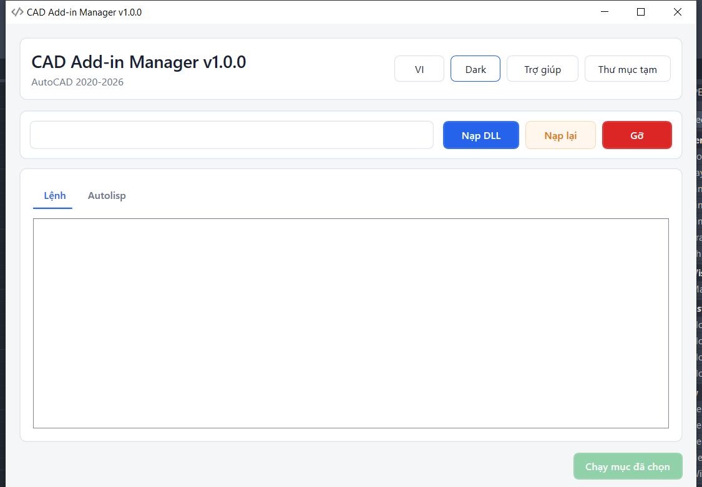

# CAD Add-in Manager

[](https://github.com/thanhphuong-dev/CADAddinManager/actions/workflows/Workflow.yml)
[](https://github.com/thanhphuong-dev/CADAddinManager/actions/workflows/release.yml)

[](License.md)

[English](README.md) | [Tiếng Việt](README.vi.md)

CAD Add-in Manager là công cụ hỗ trợ phát triển add-in trên các nền tảng CAD. Công cụ cho phép nạp, kiểm tra và chạy các lệnh .NET bên ngoài ngay trong phiên làm việc CAD đang mở — không cần biên dịch lại, nạp lại hay khởi động lại phần mềm CAD sau mỗi lần sửa đổi.

## Tính năng

- **Nạp assembly .NET bên ngoài** theo yêu cầu và duyệt toàn bộ lệnh CAD mà assembly cung cấp.
- **Chạy bất kỳ lệnh nào ngay lập tức**, chạy lại lệnh gần nhất chỉ bằng một lệnh duy nhất.
- **Nạp cách ly** — assembly được nạp từ bản sao bóng (shadow copy) nên DLL nguồn không bị khóa, có thể biên dịch lại bất cứ lúc nào.
- **Chẩn đoán** — bảng trace/log dạng palette có thể neo cửa sổ, cùng công cụ liệt kê mọi DLL không mặc định mà phần mềm CAD đã nạp.
- **Bundle tự nạp** — cài một lần, công cụ tự tạo tab ribbon khi khởi động; không cần chạy `NETLOAD`.

## Ảnh chụp màn hình

**Tab ribbon, tự nạp khi khởi động (AutoCAD 2023):**



**Cửa sổ quản lý — giao diện sáng, tiếng Anh:**



**Cửa sổ quản lý — giao diện tối, tiếng Việt:**



## Phần mềm được hỗ trợ

| Phần mềm | Phiên bản | Nền .NET | Ghi chú |
|---|---|---|---|
| AutoCAD | 2020–2026 | .NET Framework 4.8 (2020–2024), .NET 8 (2025–2026) | Build qua các gói NuGet AutoCAD .NET API |
| ZWCAD | 2021, 2026 | .NET Framework 4.8 | Build qua ZRX.NET API đi kèm bộ cài ZWCAD |
| VinaCAD | 2026.07.x | .NET 8 | Build qua VinaCAD/Teigha .NET 8 SDK |

## Các lệnh

| Lệnh | Mô tả | Phạm vi |
|---|---|---|
| `CADManager` | Mở cửa sổ quản lý add-in | Mọi phần mềm |
| `CADManagerRunLast` | Chạy lại lệnh được chọn gần nhất | Mọi phần mềm |
| `CADManagerDockPanel` | Bật/tắt bảng trace/debug có thể neo cửa sổ | Mọi phần mềm |
| `CADListLoadedDlls` | Liệt kê các DLL không mặc định đang được nạp | Mọi phần mềm |
| `CADManagerRibbon` | Tạo lại tab ribbon *Add-in Manager* | Mọi phần mềm (tự chạy khi khởi động qua bundle) |

## Cài đặt

Đóng phần mềm CAD trước khi cài đặt hoặc cập nhật.

### AutoCAD

1. Tải `CADAddinManager-<version>-setup.exe` từ trang [Releases](https://github.com/thanhphuong-dev/CADAddinManager/releases) và chạy file đó.
2. Bộ cài sẽ chép bundle vào:

   ```text
   %APPDATA%\Autodesk\ApplicationPlugins\CADAddinManager.bundle
   ```

### VinaCAD

1. Tải và chạy `CADAddinManager-VinaCAD-<version>-setup.exe`.
2. Bộ cài sẽ chép bundle vào:

   ```text
   %APPDATA%\VinaCAD\ApplicationPlugins\CADAddinManager.bundle
   ```

### ZWCAD

1. Tải và giải nén gói ZWCAD.
2. Chạy `install-zwcad.bat` trong thư mục đã giải nén.
3. Khởi động lại ZWCAD và chạy `CADManager`. Nếu bundle tự nạp không khả dụng, dùng `NETLOAD` để nạp DLL thủ công.

### Cài thủ công

Giải nén file `*-bundle.zip` tương ứng trong phần tải của bản phát hành, rồi chép thư mục `CADAddinManager.bundle` vào thư mục `ApplicationPlugins` nêu trên.

### Lần chạy đầu

Khởi động lại phần mềm CAD. Tab **Add-in Manager** sẽ xuất hiện trên ribbon — hoặc gõ `CADManager` vào dòng lệnh. Khi đã cài bundle tự nạp, bạn không bao giờ cần chạy `NETLOAD`.

## Build từ mã nguồn

### Yêu cầu

- Windows x64
- Visual Studio 2022 hoặc mới hơn
- .NET Framework 4.8 Developer Pack (AutoCAD 2020–2024, các bản ZWCAD)
- .NET 8 SDK (AutoCAD 2025–2026, VinaCAD)
- Đã cài VinaCAD 2026 trên máy, để build cấu hình `V26`
- Đã cài ZWCAD 2021 / 2026 trên máy, để build cấu hình `Z21` / `Z26`

### Các cấu hình build

Mỗi phần mềm được hỗ trợ có cấu hình build riêng:

| Cấu hình | Phần mềm | Cấu hình | Phần mềm |
|---|---|---|---|
| `Debug/Release A20` | AutoCAD 2020 | `Debug/Release A25` | AutoCAD 2025 |
| `Debug/Release A21` | AutoCAD 2021 | `Debug/Release A26` | AutoCAD 2026 |
| `Debug/Release A22` | AutoCAD 2022 | `Debug/Release V26` | VinaCAD 2026 |
| `Debug/Release A23` | AutoCAD 2023 | `Debug/Release Z21` | ZWCAD 2021 |
| `Debug/Release A24` | AutoCAD 2024 | `Debug/Release Z26` | ZWCAD 2026 |

### Build

```powershell
dotnet restore CADAddinManager.sln --property:Configuration="Release A26"
dotnet build CADAddinManager.sln --configuration "Release A26" --no-restore
```

Nếu SDK được cài ở thư mục không mặc định, chỉ định đường dẫn khi build:

```powershell
# VinaCAD (mặc định: C:\Program Files\VinaCAD\VinaCAD 2026)
dotnet build CADAddinManager.sln --configuration "Release V26" -p:VinaCadInstallDir="D:\VinaCAD 2026"

# ZWCAD (mặc định: C:\Program Files\ZWSOFT\ZWCAD <version>)
dotnet build CADAddinManager.sln --configuration "Release Z26" -p:ZwcadInstallDir="D:\ZWSOFT\ZWCAD 2026"
```

## Triển khai bundle trên máy phát triển

Để phát triển hàng ngày, deploy bundle thẳng vào thư mục autoload của phần mềm CAD:

```powershell
# Bundle debug cho AutoCAD
dotnet build CADAddinManager.sln --configuration "Debug A26" -p:DeployToAutoCAD=true

# Bundle release cho VinaCAD
dotnet build CADAddinManager.sln --configuration "Release V26" -p:DeployToVinaCAD=true
```

## Đóng gói và phát hành

Tạo toàn bộ gói ZIP/EXE cho AutoCAD và VinaCAD trong một bước:

```powershell
.\tools\package-all.ps1 -Version v1.1.0
```

Hoặc chạy từng bước đóng gói riêng lẻ:

```powershell
.\tools\package-release.ps1 -Version v1.1.0
.\tools\package-vinacad.ps1 -Version v1.1.0
.\tools\package-zwcad.ps1 -Version v1.1.0
.\tools\build-installer.ps1 -Version v1.1.0
.\tools\build-vinacad-installer.ps1 -Version v1.1.0
```

Toàn bộ kết quả được ghi vào thư mục `artifacts/`.

Khi push một tag dạng `v*`, workflow release sẽ tự động chạy: build các gói AutoCAD trên GitHub-hosted runner và đính kèm vào GitHub Release. Gói VinaCAD và ZWCAD cần được đóng gói thủ công trên máy có cài SDK tương ứng.

## Cấu trúc dự án

```text
src/CADAddinManager/
  Command/                       Các điểm vào lệnh CAD
  Model/                          Bộ máy nạp add-in và tiện ích
  View/                           Giao diện và control WPF
  ViewModel/                      Trạng thái UI và lệnh
  PackageContents.xml             Manifest bundle AutoCAD
  PackageContents.VinaCAD.xml     Manifest bundle VinaCAD
tools/                            Script đóng gói và tạo bộ cài
.github/workflows/                Tự động hóa CI build và release
```

## Đóng góp

Mọi đóng góp đều được hoan nghênh. Vui lòng đọc [CONTRIBUTING.md](CONTRIBUTING.md) (hoặc [CONTRIBUTING.vi.md](CONTRIBUTING.vi.md)) trước khi tạo pull request.

## Giấy phép

Dự án được phát hành theo [Giấy phép MIT](License.md).
